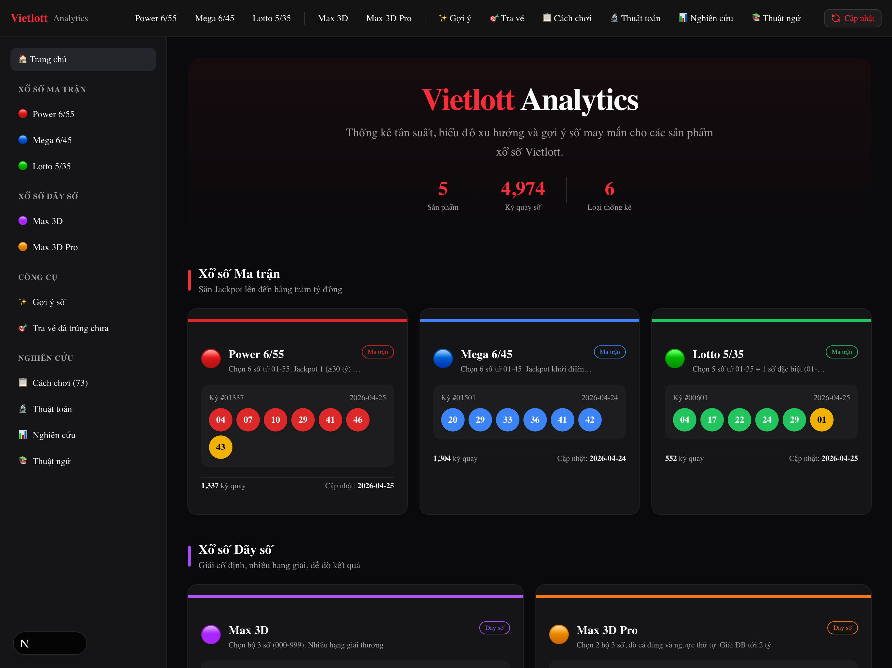
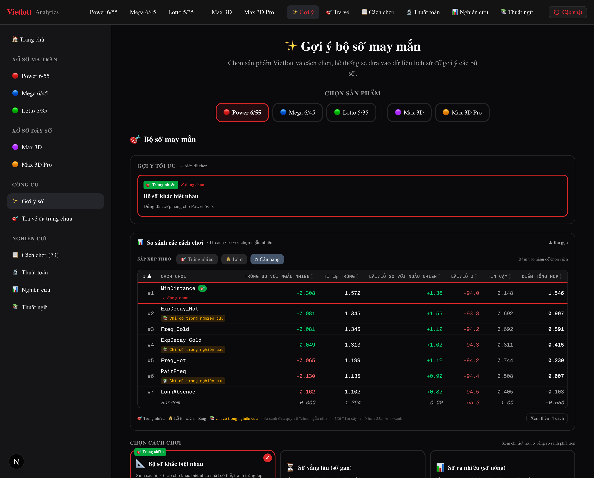
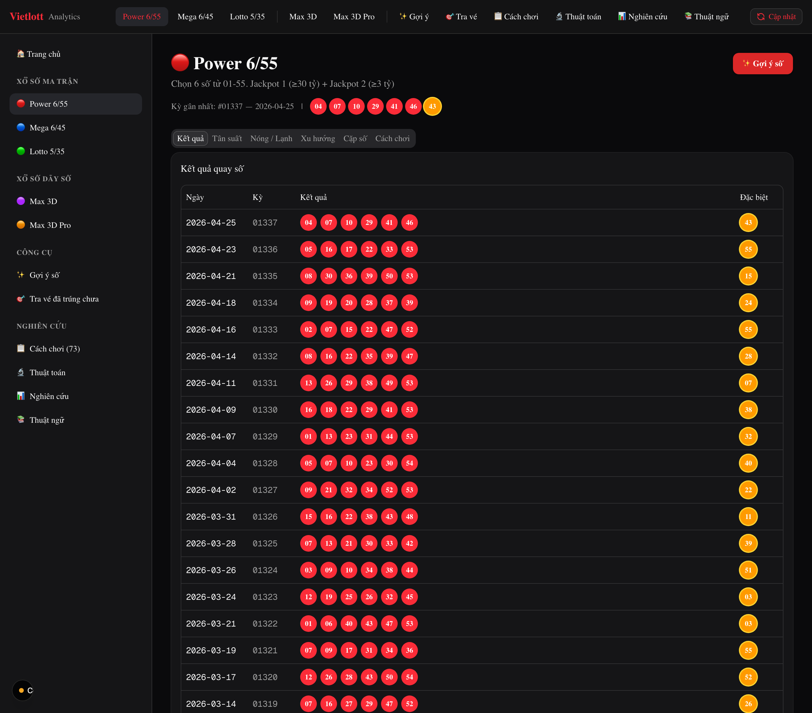
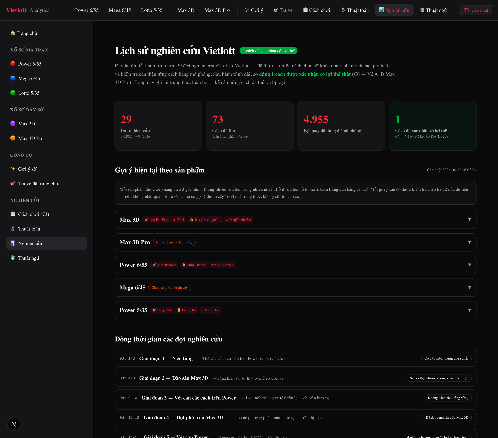

# 🎰 Vietlott Analytics

**English** · [Tiếng Việt](README.vi.md)

> Can any algorithm beat random on the Vietnamese lottery? This project is the rigorous, open-source attempt to find out — plus the number-suggestion toolkit and web app built along the way.

[](LICENSE)
[](https://nextjs.org/)
[](https://react.dev/)
[](https://www.python.org/)

---

## 🎯 The Question

The lottery is designed to be random and negative-sum. But "designed to be" is a hypothesis, not a proof. So we asked a concrete, testable question:

> **Is there any strategy that consistently beats a random pick on real Vietlott draws?**

To answer it, we built a backtesting framework, ran dozens of strategies against nine years of historical draws, and held every promising result to statistical scrutiny — autocorrelation tests, stability-over-time checks, and the NIST randomness test suite.

## 🔬 The Honest Answer

| Metric | Value |
|--------|-------|
| Research cycles | **29** (07/2025 → 04/2026) |
| Methods tried | **73** |
| Draws used in backtests | **4,955** |
| Strategies with a confirmed edge | **1** |

After 29 cycles, the verdict is overwhelmingly: **no.** Almost every "promising" pattern collapsed under proper testing — small samples make luck look like skill. The single confirmed edge is narrow and not a money-maker:

- **C6 — "A=B" on Max 3D Pro** (cycles 27–29): a structural quirk yielding **+10–11%** over expectation. It is real and reproducible, but the product's expected value remains negative, so it does not turn a profit.

That negative result *is* the contribution: a transparent, reproducible demonstration of how rarely lottery strategies survive rigorous testing — and a toolkit honest enough to label what it cannot prove.

> **Disclaimer.** This is a data-science and educational project. The lottery is a game of chance with negative expected value. Nothing here predicts winning numbers or constitutes gambling advice.

---

## 🧰 The Toolkit

What the research produced: a number-suggestion engine and an interactive web app, both driven by backtested data rather than superstition.

### Web app

A [Next.js 16](https://nextjs.org/) application (under [`website/`](website/)) — the project's primary interface.

**Supported products**

| Product | Format | Category |
|---------|--------|----------|
| **Power 6/55** | Pick 6 of 1–55 | Matrix (Jackpot) |
| **Mega 6/45** | Pick 6 of 1–45 | Matrix (Jackpot) |
| **Lotto 5/35** | Pick 5 of 1–35 | Matrix |
| **Max 3D** | 3-digit draw | Number-string |
| **Max 3D Pro** | 3-digit draw, multi-prize | Number-string |

**Features**

- **📊 Statistics & charts** — all-time and rolling-window (30/60/90-day) frequency, hot/cold numbers, pair frequency, and trend lines ([Recharts](https://recharts.org/)).
- **🎯 Number suggestions** — a 3-pick structure per product: highest hit-rate, lowest loss (ROI), and balanced — each chosen from backtested composite scores. When no pick survives verification, the app says so instead of faking confidence.
- **🔬 Algorithm comparison** — strategies backtested over thousands of real draws, with sortable win-rate / ROI tables.
- **📋 Methods catalog** — the 73 methods that were tried, classified by outcome, including the single one with a verified edge.
- **🎟️ Ticket checker** — paste your numbers (CSV) and see which prizes they would have won across history.
- **📝 Research log** — a transparent record of all 29 research cycles: what was tested, what failed replication, what survived.
- **📖 Glossary** — plain-language explanations of every metric and term.

### Command-line tool

The Python backend ([`src/vietlott/`](src/vietlott/), [`src/machine_learning/`](src/machine_learning/)) ships a CLI for crawling data, generating suggestions, and running backtests:

```bash
vietlott-crawl power_655      # crawl latest results
vietlott-suggest power_535    # generate backtested number suggestions
vietlott-missing power_655    # backfill missing draw IDs
```

---

## 📸 Screenshots

| Home | Number suggestions vs. random |
|------|-------------------------------|
| [](docs/screenshots/home.png) | [](docs/screenshots/suggest.png) |
| **Per-product statistics** | **Research log** |
| [](docs/screenshots/power655.png) | [](docs/screenshots/research.png) |

---

## 📐 Methodology

Every strategy is held to the same bar — a result only counts if it survives:

1. **Backtesting** — replayed against historical draws (4,955 used to date), never the data it was tuned on.
2. **Split-half verification** — the edge must hold on both halves of the sample, in the same direction.
3. **Randomness tests** — autocorrelation between draws, stability over time, and the NIST statistical test suite.
4. **Honest labeling** — a strategy that merely "looks good" is shipped as such; only a 3-gate pass earns a confirmed-edge label. Null results are reported as null.

See the in-app [Research log](website/research/) and [`website/CLAUDE.md`](website/CLAUDE.md) for the full methodology and per-cycle history.

---

## 🚀 Quick Start

### Web app

```bash
# From the repo root
make website-install   # install web dependencies (first run only)
make website-dev       # build data + start the dev server on http://localhost:3000
```

`make website-dev` regenerates `website/public/data/*.json` from `data/*.jsonl`
automatically before starting the server.

Or directly inside [`website/`](website/):

```bash
cd website
npm install
npm run dev            # development
npm run build          # production build (also runs the full type check)
npm run start          # serve the production build
```

The app builds and deploys as a standard Next.js application (e.g. Vercel or any Node host).

### Python backend

```bash
uv sync --extra dev          # or: pip install -e .

vietlott-crawl power_655     # crawl latest results for a product
vietlott-suggest power_535   # generate number suggestions
vietlott-missing power_655   # backfill missing draw IDs
```

Available products: `power_655`, `power_645`, `power_535`, `keno`, `3d`, `3d_pro`, `bingo18`.

---

## ⚙️ Data Pipeline

```
vietlott.vn  ──crawl──▶  data/*.jsonl  ──build_data.py──▶  website/public/data/*.json  ──▶  Web App
```

1. **Crawl** — a Python package fetches each product's results directly from [vietlott.vn](https://vietlott.vn/) and stores them as deduplicated, date-sorted JSONL.
2. **Build** — [`website/scripts/build_data.py`](website/scripts/build_data.py) transforms the JSONL into the compact JSON the UI consumes (`make website-data`).
3. **Serve** — the Next.js app renders statistics, charts, and suggestions from that JSON.

Each draw record is `{ date, id, result, process_time }`.

---

## 🗂️ Repository Layout

```
.
├── website/              # Next.js 16 web app (the primary interface)
│   ├── src/app/          # App Router routes (home, suggest, algorithms, methods, research, check-rate, glossary, per-product)
│   ├── src/components/   # UI components (products, charts, check-rate, layout, ui)
│   ├── src/lib/          # data loaders, suggestion engines, product config, types
│   ├── public/data/      # generated JSON consumed by the UI
│   ├── scripts/          # build_data.py (JSONL → JSON)
│   └── research/         # research artifacts (backtests + markdown logs)
├── src/vietlott/         # Python crawler + CLI (crawl, missing, suggest)
├── src/machine_learning/ # backtesting + suggestion strategies
└── data/                 # raw draw history (JSONL)
```

---

## 🧪 Development

```bash
# Web
make website-build               # production build (catches type errors)
cd website && npx tsc --noEmit   # type check only

# Python
make test                        # run the test suite
make lint                        # ruff check + format
```

See [`CLAUDE.md`](CLAUDE.md) and [`website/CLAUDE.md`](website/CLAUDE.md) for developer guides, and [`CONTRIBUTING.md`](CONTRIBUTING.md) for contribution guidelines.

---

## 🙏 Acknowledgements

This project is inspired by [vietvudanh/vietlott-data](https://github.com/vietvudanh/vietlott-data), whose crawler and data approach laid the groundwork. The research, suggestion engines, and web app in this repository build on that foundation.

---

## 📄 License

Released under the [MIT License](LICENSE). For educational and research purposes only — not affiliated with Vietlott, and not gambling advice.

---

<div align="center">
  <strong>⭐ If you find this project useful, consider giving it a star.</strong>
</div>
