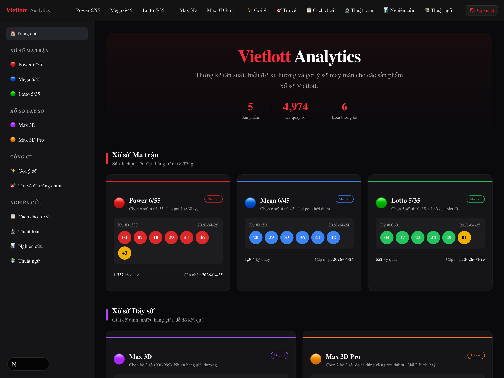
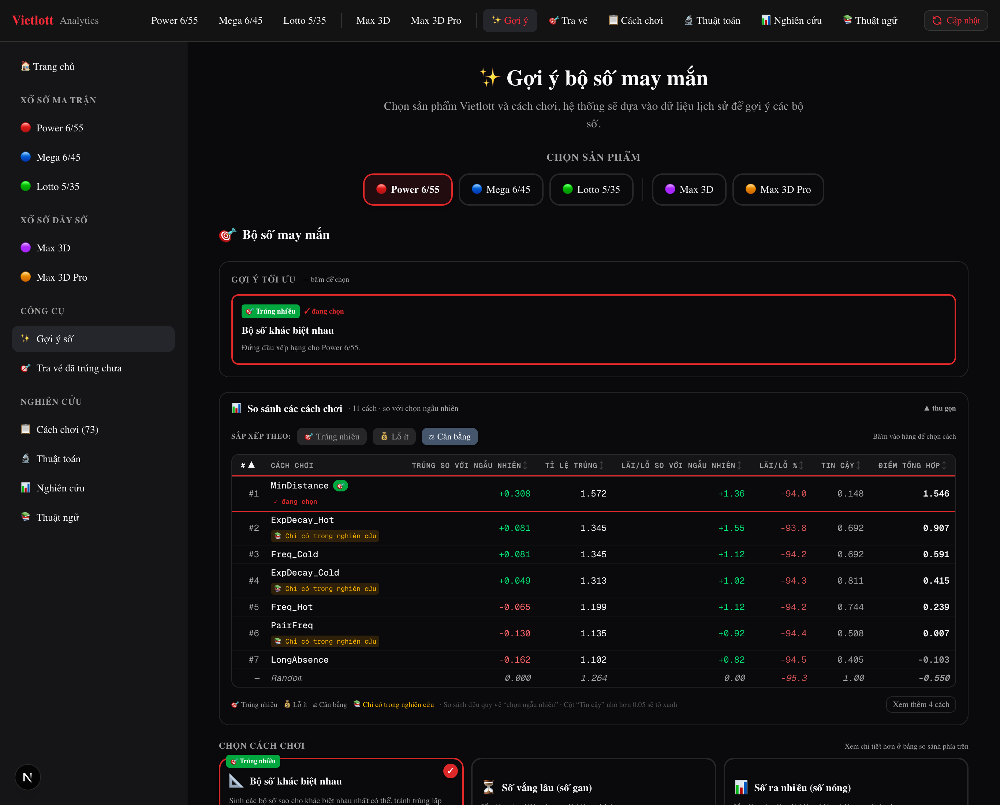
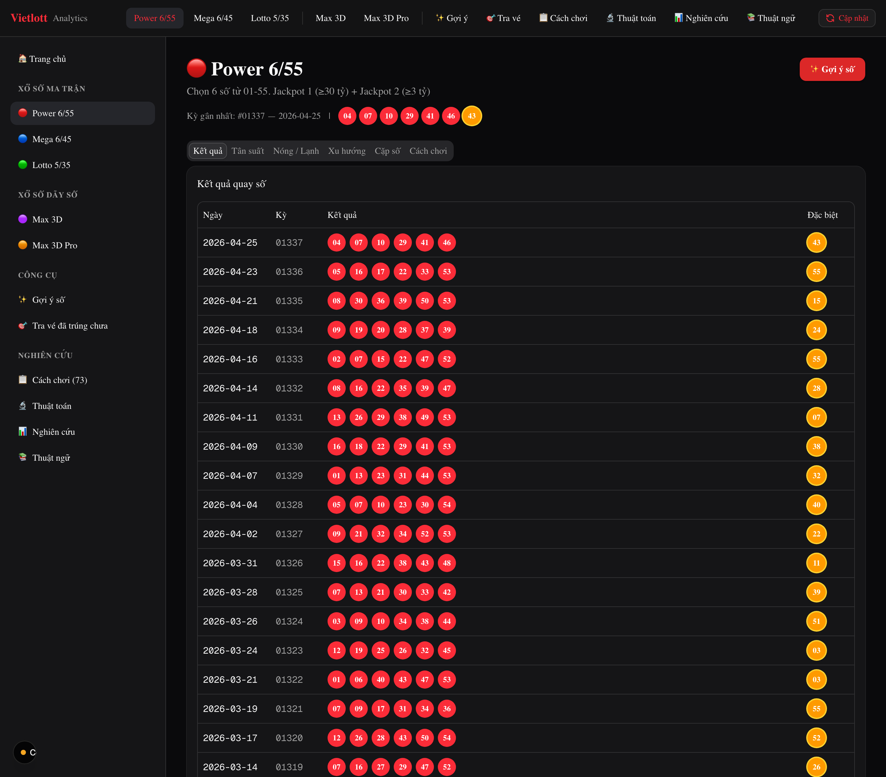
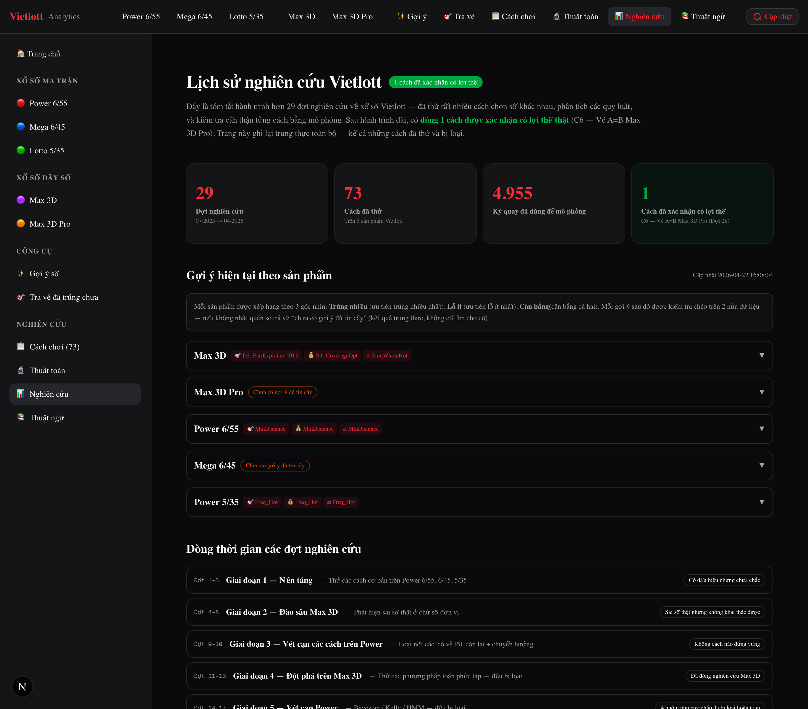

# 🎰 Vietlott Analytics

[English](README.md) · **Tiếng Việt**

> Liệu có thuật toán nào đánh bại lối chọn ngẫu nhiên trên xổ số Vietlott? Đây là dự án mã nguồn mở nỗ lực trả lời câu hỏi đó một cách nghiêm túc — cùng bộ công cụ gợi ý số và web app được xây dựng trong quá trình nghiên cứu.

[](LICENSE)
[](https://nextjs.org/)
[](https://react.dev/)
[](https://www.python.org/)

---

## 🎯 Câu hỏi

Xổ số được thiết kế để ngẫu nhiên và có kỳ vọng âm. Nhưng "được thiết kế để" là một giả thuyết, không phải bằng chứng. Vì vậy dự án đặt ra một câu hỏi cụ thể, có thể kiểm chứng:

> **Có chiến lược nào đánh bại lối chọn ngẫu nhiên một cách ổn định trên các kỳ quay Vietlott thực tế không?**

Để trả lời, dự án xây dựng một khung backtest, chạy hàng chục chiến lược trên chín năm dữ liệu lịch sử, và đưa mọi kết quả "có vẻ tốt" qua các bài kiểm định thống kê — kiểm tra tự tương quan, độ ổn định theo thời gian, và bộ kiểm định ngẫu nhiên NIST.

## 🔬 Câu trả lời trung thực

| Chỉ số | Giá trị |
|--------|---------|
| Số đợt nghiên cứu | **29** (07/2025 → 04/2026) |
| Số cách đã thử | **73** |
| Số kỳ quay dùng để mô phỏng | **4.955** |
| Số chiến lược có lợi thế đã xác nhận | **1** |

Sau 29 đợt, kết luận áp đảo là: **không.** Gần như mọi "quy luật có vẻ tốt" đều sụp đổ khi kiểm định đúng cách — mẫu nhỏ khiến may rủi trông như kỹ năng. Lợi thế duy nhất được xác nhận cũng rất hẹp và không sinh lời:

- **C6 — "A=B" trên Max 3D Pro** (đợt 27–29): một đặc tính cấu trúc cho **+10–11%** so với kỳ vọng. Đây là lợi thế thật và tái lập được, nhưng kỳ vọng của sản phẩm vẫn âm, nên không tạo ra lợi nhuận.

Chính kết quả âm đó *là* đóng góp: một minh chứng minh bạch, tái lập được về việc các chiến lược xổ số hiếm khi sống sót qua kiểm định nghiêm túc — và một bộ công cụ đủ trung thực để gắn nhãn đúng những gì nó không chứng minh được.

> **Lưu ý.** Đây là dự án khoa học dữ liệu và giáo dục. Xổ số là trò chơi may rủi với kỳ vọng âm. Không có nội dung nào ở đây dự đoán số trúng hay là lời khuyên cờ bạc.

---

## 🧰 Bộ công cụ

Thành quả của nghiên cứu: một engine gợi ý số và một web app tương tác, đều dựa trên dữ liệu đã backtest chứ không phải mê tín.

### Web app

Một ứng dụng [Next.js 16](https://nextjs.org/) (trong [`website/`](website/)) — giao diện chính của dự án.

**Sản phẩm hỗ trợ**

| Sản phẩm | Thể thức | Loại |
|----------|----------|------|
| **Power 6/55** | Chọn 6 từ 1–55 | Ma trận (Jackpot) |
| **Mega 6/45** | Chọn 6 từ 1–45 | Ma trận (Jackpot) |
| **Lotto 5/35** | Chọn 5 từ 1–35 | Ma trận |
| **Max 3D** | Quay 3 chữ số | Dãy số |
| **Max 3D Pro** | Quay 3 chữ số, nhiều hạng giải | Dãy số |

**Tính năng**

- **📊 Thống kê & biểu đồ** — tần suất toàn thời gian và theo cửa sổ trượt (30/60/90 ngày), số nóng/lạnh, tần suất cặp, đường xu hướng ([Recharts](https://recharts.org/)).
- **🎯 Gợi ý số** — cấu trúc 3 lựa chọn mỗi sản phẩm: tỷ lệ trúng cao nhất, lỗ ít nhất (ROI), và cân bằng — mỗi lựa chọn rút từ điểm tổng hợp đã backtest. Khi không lựa chọn nào vượt qua kiểm định, app nói thẳng thay vì giả vờ tự tin.
- **🔬 So sánh thuật toán** — các chiến lược được backtest trên hàng nghìn kỳ quay thực, kèm bảng tỷ lệ trúng / ROI sắp xếp được.
- **📋 Danh mục cách chơi** — 73 cách đã thử, phân loại theo kết quả, gồm cả cách duy nhất có lợi thế đã xác nhận.
- **🎟️ Dò vé** — dán bộ số (CSV) và xem chúng từng trúng giải nào trong lịch sử.
- **📝 Nhật ký nghiên cứu** — ghi chép minh bạch cả 29 đợt: đã thử gì, cái gì thất bại khi tái lập, cái gì sống sót.
- **📖 Thuật ngữ** — giải thích dễ hiểu mọi chỉ số và khái niệm.

### Công cụ dòng lệnh

Backend Python ([`src/vietlott/`](src/vietlott/), [`src/machine_learning/`](src/machine_learning/)) cung cấp CLI để crawl dữ liệu, sinh gợi ý, và chạy backtest:

```bash
vietlott-crawl power_655      # crawl kết quả mới nhất
vietlott-suggest power_535    # sinh gợi ý số đã backtest
vietlott-missing power_655    # bù các kỳ quay còn thiếu
```

---

## 📸 Ảnh chụp màn hình

| Trang chủ | Gợi ý số so với ngẫu nhiên |
|-----------|----------------------------|
| [](docs/screenshots/home.png) | [](docs/screenshots/suggest.png) |
| **Thống kê theo sản phẩm** | **Nhật ký nghiên cứu** |
| [](docs/screenshots/power655.png) | [](docs/screenshots/research.png) |

---

## 📐 Phương pháp luận

Mọi chiến lược đều bị đánh giá theo cùng một chuẩn — một kết quả chỉ được tính nếu nó sống sót qua:

1. **Backtest** — chạy lại trên dữ liệu lịch sử (đến nay đã dùng 4.955 kỳ), không bao giờ trên chính dữ liệu dùng để tinh chỉnh.
2. **Kiểm định chia đôi (split-half)** — lợi thế phải giữ vững trên cả hai nửa của mẫu, cùng một chiều.
3. **Kiểm định ngẫu nhiên** — tự tương quan giữa các kỳ, độ ổn định theo thời gian, và bộ kiểm định thống kê NIST.
4. **Gắn nhãn trung thực** — chiến lược chỉ "trông có vẻ tốt" sẽ được dán nhãn đúng như vậy; chỉ khi vượt qua đủ 3 cổng mới được gắn nhãn lợi thế-đã-xác-nhận. Kết quả rỗng được báo cáo là rỗng.

Xem [Nhật ký nghiên cứu](website/research/) trong app và [`website/CLAUDE.md`](website/CLAUDE.md) để biết đầy đủ phương pháp và lịch sử từng đợt.

---

## 🚀 Bắt đầu nhanh

### Web app

```bash
# Từ thư mục gốc repo
make website-install   # cài dependency cho web (chỉ lần đầu)
make website-dev       # build dữ liệu + chạy dev server tại http://localhost:3000
```

`make website-dev` tự động sinh lại `website/public/data/*.json` từ `data/*.jsonl`
trước khi khởi động server.

Hoặc chạy trực tiếp trong [`website/`](website/):

```bash
cd website
npm install
npm run dev            # phát triển
npm run build          # build production (chạy luôn full type check)
npm run start          # chạy bản production
```

App build và deploy như một ứng dụng Next.js tiêu chuẩn (ví dụ Vercel hoặc bất kỳ host Node nào).

### Backend Python

```bash
uv sync --extra dev          # hoặc: pip install -e .

vietlott-crawl power_655     # crawl kết quả mới nhất của một sản phẩm
vietlott-suggest power_535   # sinh gợi ý số
vietlott-missing power_655   # bù các kỳ quay còn thiếu
```

Sản phẩm hỗ trợ: `power_655`, `power_645`, `power_535`, `keno`, `3d`, `3d_pro`, `bingo18`.

---

## ⚙️ Luồng dữ liệu

```
vietlott.vn  ──crawl──▶  data/*.jsonl  ──build_data.py──▶  website/public/data/*.json  ──▶  Web App
```

1. **Crawl** — package Python lấy kết quả từng sản phẩm trực tiếp từ [vietlott.vn](https://vietlott.vn/) và lưu dưới dạng JSONL đã khử trùng lặp, sắp theo ngày.
2. **Build** — [`website/scripts/build_data.py`](website/scripts/build_data.py) chuyển JSONL thành JSON gọn mà UI dùng (`make website-data`).
3. **Serve** — app Next.js render thống kê, biểu đồ và gợi ý từ JSON đó.

Mỗi bản ghi kỳ quay có dạng `{ date, id, result, process_time }`.

---

## 🗂️ Cấu trúc repo

```
.
├── website/              # Web app Next.js 16 (giao diện chính)
│   ├── src/app/          # Route App Router (home, suggest, algorithms, methods, research, check-rate, glossary, từng sản phẩm)
│   ├── src/components/   # Component UI (products, charts, check-rate, layout, ui)
│   ├── src/lib/          # data loader, engine gợi ý, cấu hình sản phẩm, types
│   ├── public/data/      # JSON sinh ra cho UI dùng
│   ├── scripts/          # build_data.py (JSONL → JSON)
│   └── research/         # tài liệu nghiên cứu (backtest + nhật ký markdown)
├── src/vietlott/         # Crawler + CLI Python (crawl, missing, suggest)
├── src/machine_learning/ # backtest + các chiến lược gợi ý
└── data/                 # dữ liệu kỳ quay thô (JSONL)
```

---

## 🧪 Phát triển

```bash
# Web
make website-build               # build production (bắt lỗi type)
cd website && npx tsc --noEmit   # chỉ kiểm tra type

# Python
make test                        # chạy test
make lint                        # ruff check + format
```

Xem [`CLAUDE.md`](CLAUDE.md) và [`website/CLAUDE.md`](website/CLAUDE.md) để biết hướng dẫn dev, và [`CONTRIBUTING.md`](CONTRIBUTING.md) cho hướng dẫn đóng góp.

---

## 🙏 Ghi nhận

Dự án lấy cảm hứng từ [vietvudanh/vietlott-data](https://github.com/vietvudanh/vietlott-data), với crawler và cách tiếp cận dữ liệu làm nền móng. Phần nghiên cứu, engine gợi ý và web app trong repo này được xây dựng trên nền tảng đó.

---

## 📄 Giấy phép

Phát hành theo [Giấy phép MIT](LICENSE). Chỉ phục vụ mục đích giáo dục và nghiên cứu — không liên kết với Vietlott, và không phải lời khuyên cờ bạc.

---

<div align="center">
  <strong>⭐ Nếu thấy dự án hữu ích, hãy cân nhắc tặng một sao.</strong>
</div>
